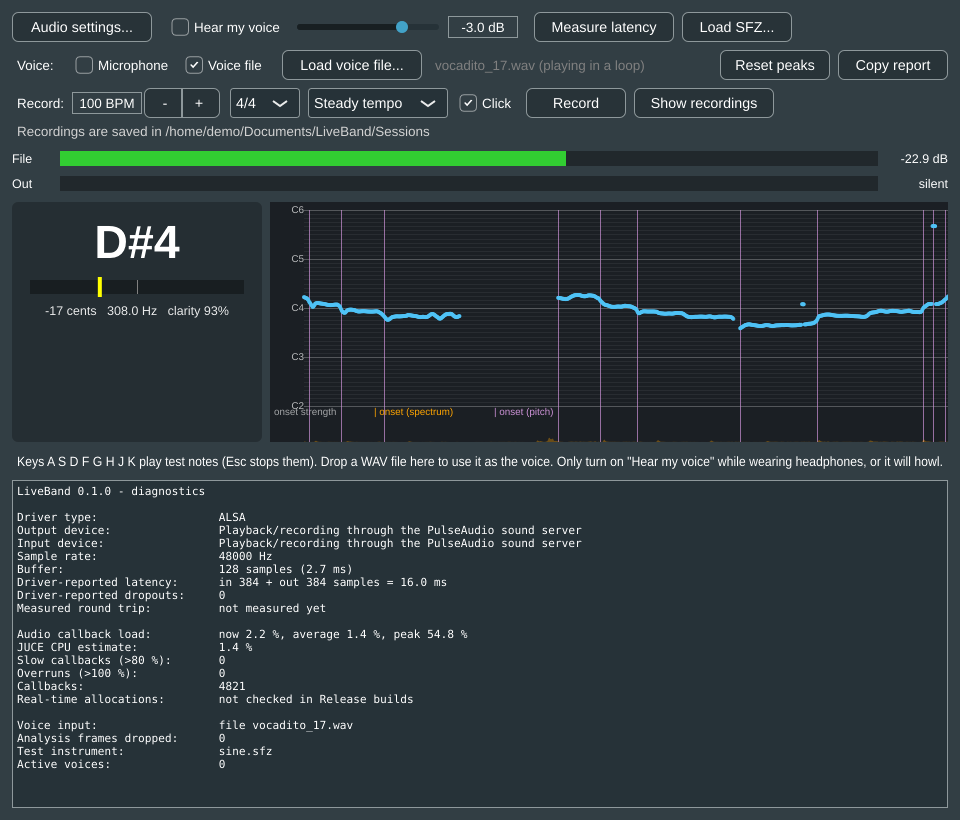

# LiveBand

An offline Windows app that listens to a live singer and plays drums,
percussion, bass and keys that follow the singer's key and tempo. Built for the
Nigerian market: Afrobeats and worship styles first.

**Status: Phase 1 done** (listening). The app hears the singer: it shows the
note being sung and a scrolling pitch graph, finds where notes start, can listen
to a voice file instead of the mic, and records test sessions with a click
track. It also passes the voice through, plays a test instrument through sfizz,
measures round-trip latency and shows live diagnostics. No band yet: that is
Phase 2.



On 40 clips of real singing (the vocadito dataset), 97% of pitch frames are within
50 cents of the truth and the onset F-measure is 0.76. See the
[Phase 1 results](docs/results/PHASE1_RESULTS.md).

- [Project brief](docs/SPEC.md)
- [Implementation plan](docs/IMPLEMENTATION_PLAN.md), with decisions in
  section 0
- [Windows setup and first tests](docs/WINDOWS_SETUP.md)
- [Recording the test set](docs/RECORDING_GUIDE.md)

## Building

The code is C++20 with CMake. JUCE and sfizz are git submodules, so clone with
them:

```
git clone --recursive --shallow-submodules https://github.com/syflex/Live-band.git
```

### Windows (the target platform)

Use Visual Studio 2022 with the **Desktop development with C++** workload.
Open the folder in Visual Studio and pick the **Windows Release (MSVC)**
preset, or from a "Developer PowerShell for VS 2022":

```
cmake --preset windows-release
cmake --build --preset windows-release
ctest --preset windows-release
```

The app is written to `out/build/windows-release/LiveBand_artefacts/Release/`.
Every push also builds it on GitHub Actions; see
[docs/WINDOWS_SETUP.md](docs/WINDOWS_SETUP.md) for downloading that build.

### Linux (development only)

Linux builds are for compile checks and tests. The core library and its tests
need only a compiler:

```
cmake --preset linux-core && cmake --build --preset linux-core && ctest --preset linux-core
```

The full app also needs JUCE's Linux dependencies (see
`.github/workflows/ci.yml`), then uses the `linux-debug` or `linux-release`
preset.

### Offline evaluation

`lb-analyze` runs the app's voice analysis over audio files and writes CSVs.
The scripts in `tools/python` score it against reference pitch tracks and note
annotations:

```
python -m venv .venv && .venv/bin/pip install -r tools/python/requirements.txt
.venv/bin/python tools/python/fetch_vocadito.py
.venv/bin/python tools/python/eval_pitch.py  --analyzer <path to lb-analyze> --vocadito testdata/external/vocadito
.venv/bin/python tools/python/eval_onsets.py --analyzer <path to lb-analyze> --vocadito testdata/external/vocadito
```

CI runs the same evaluation on every push and fails if accuracy drops below the
Phase 1 targets.

## Layout

```
src/common   lock-free queue, callback timing, allocation guard, pitch helpers ┐ core library:
src/audio    YIN pitch, onsets, vocal analyzer, decimator, FFT, latency       │ no JUCE, unit-tested
src/music    click track now; key, tempo and arranger from Phase 2            ┘
src/engine   audio engine, device setup, session recorder, sfizz instrument (JUCE)
src/ui       note display and pitch view
src/Main.cpp, src/MainComponent.*   the app window
tests/       Catch2 tests; tests/engine drives the audio engine with a fake device
tools/       lb-analyze (offline analysis) and Python evaluation scripts
assets/      sound kits (downloaded) and grooves
libs/        JUCE and sfizz submodules
```

## Licence

LiveBand is licensed under the [GNU AGPLv3](LICENSE). It uses JUCE under
JUCE's AGPLv3 option; a closed-source or paid product would need a commercial
JUCE licence. Third-party components and their licences are listed in
[THIRD_PARTY.md](THIRD_PARTY.md).
