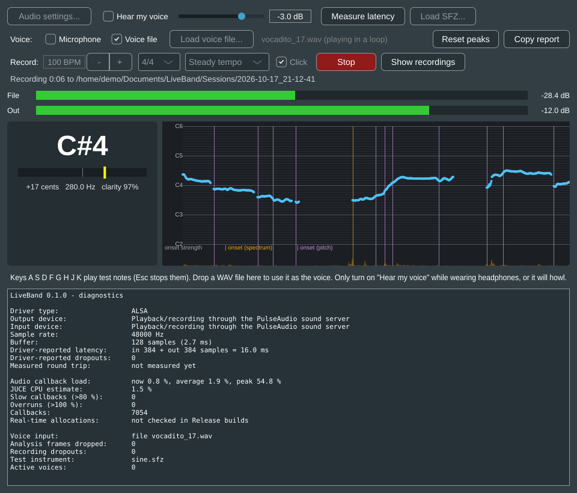
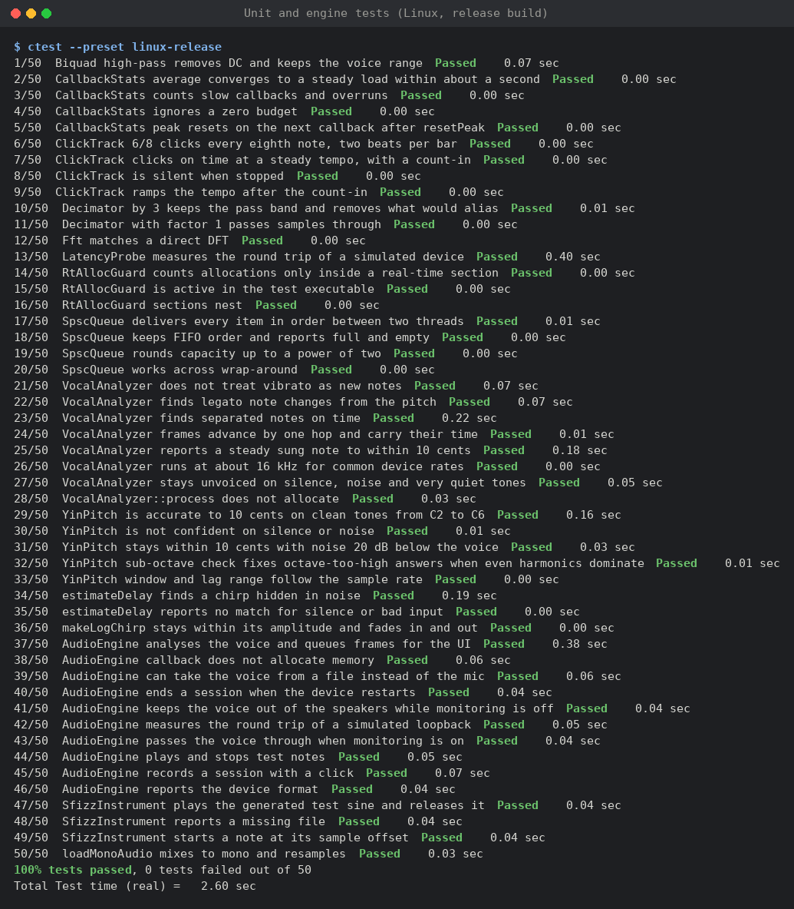
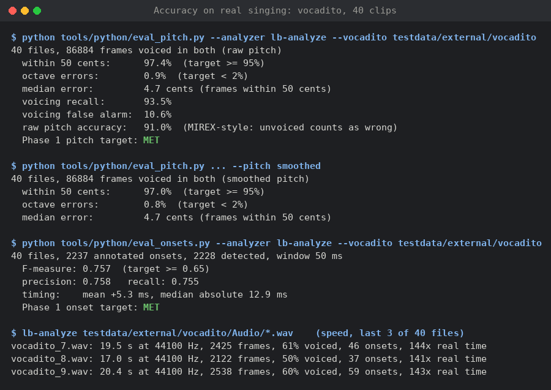
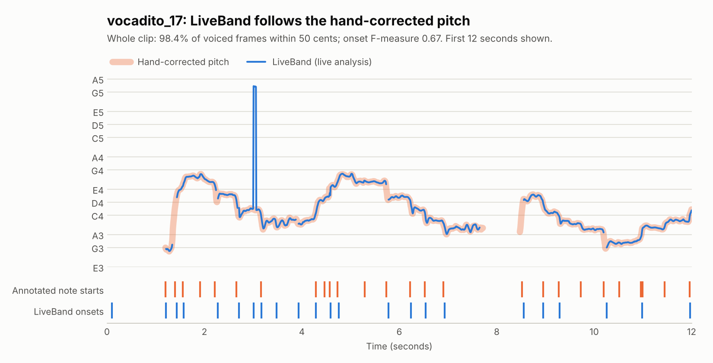
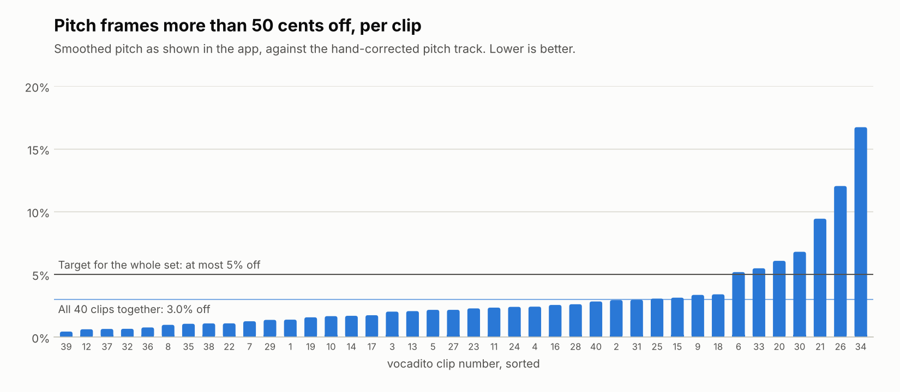

# Phase 1 results: listening to the singer

Measured on 17 October 2026, on the `phase-1-listen` branch.

## Summary

| Phase 1 exit criterion | Result | Target | |
|---|---|---|---|
| Pitch error on synthetic tones | under 10 cents from C2 to C6 (unit tests) | < 10 cents | met |
| Pitch on real singing: frames within 50 cents | **97.4%** (smoothed pitch 97.0%) | ≥ 95% | met |
| Pitch on real singing: octave errors | **0.9%** (smoothed pitch 0.8%) | < 2% | met |
| Onset F-measure on real singing, 50 ms window | **0.757** (annotator 1), 0.736 (annotator 2) | ≥ 0.65 | met |
| Analysis cost | about **128× faster than real time**, under 1% of one CPU core | < 5% of the callback budget | met |

Real singing here means the **vocadito** dataset, not yet Nigerian singers. The plan's
own test set (Nigerian singers, Nigerian songs) still has to be recorded; see
[RECORDING_GUIDE.md](../RECORDING_GUIDE.md). These numbers show the analysis works on real
voices. They need to be repeated on that test set.

## Screenshots

The app, listening to a vocadito clip as its voice input. These were taken on Linux
in the cloud test environment, with a virtual screen and a virtual sound device
running at real-time speed. Real-hardware numbers come from the Windows test in
[WINDOWS_SETUP.md](../WINDOWS_SETUP.md).


The same clip while a session records (the button reads Stop, the click shows on the
output meter, and there are no recording dropouts):



All 50 unit and engine tests, and the evaluation on vocadito:





## The test material

[vocadito](https://doi.org/10.5281/zenodo.5578807) (Bittner, Pasalo, Bosch, Meseguer Brocal
and Rubinstein, 2021; CC BY 4.0) has 40 solo-singing clips, 13.6 minutes in all, by
several singers in seven languages. Each clip has a hand-corrected pitch track and note
lists from two annotators. The clips are 44.1 kHz mono, which also tests the
non-48 kHz path (analysis at 14.7 kHz).

The dataset is downloaded by `tools/python/fetch_vocadito.py` and is not stored in this
repository.

## Pitch

`lb-analyze` runs the same `VocalAnalyzer` the app uses, and `eval_pitch.py` compares
its frames with the reference pitch track.



The spike near 3 seconds is a real glitch: for seven frames (56 ms), YIN reported three
times the true frequency (828 Hz instead of 276 Hz), an octave and a fifth too high. The
sub-octave check only looks at twice the period, and the 5-frame outlier smoothing cannot
remove a run that long. Extending the check to three times the period is a candidate
improvement for Phase 3, where key detection will be sensitive to such errors.



| Measure | Raw YIN | Smoothed (shown in the app) |
|---|---|---|
| Frames within 50 cents (both voiced) | 97.4% | 97.0% |
| Octave errors | 0.9% | 0.8% |
| Median error, frames within 50 cents | 4.7 cents | 4.7 cents |
| Voicing recall | 93.5% | 93.5% |
| Voicing false alarm | 10.6% | 10.6% |
| Raw pitch accuracy (MIREX-style, unvoiced counts as wrong) | 91.0% | — |

What the tuning changed, measured on the same data:

- **Smoothing only replaces outliers.** A plain 5-frame median lagged behind vibrato and
  glides and scored 87% within 50 cents. Now a frame keeps its own value unless it is more
  than a semitone from the median: 97.0%.
- **Sub-octave check.** YIN sometimes answers an octave too high when the second harmonic
  is stronger than the fundamental. The check picks the doubled period when its dip is
  much deeper than the chosen one, comparing interpolated dip depths. It cut octave
  errors from 1.2% to 0.8% (smoothed) and fixed most of them on the worst clips
  (`vocadito_2`: 7.2% to 3.0%). One clip, `vocadito_34`, still has 15% octave errors, of
  a kind this check does not catch.
- **Voicing hold** lowered from 0.3 to 0.2: fewer voicing false alarms (13.5% to 10.6%).

**Still open:** voicing false alarms are about 10%. Most are breathy note tails and
quiet frames that the annotators marked unvoiced. They matter little for key detection,
but the level gate (-50 dBFS) should be calibrated to the headset mic once real
recordings exist.

## Onsets

`eval_onsets.py` compares onsets with the annotated note starts (`mir_eval`, 50 ms
window).

| Measure | Annotator 1 | Annotator 2 |
|---|---|---|
| F-measure | 0.757 | 0.736 |
| Precision | 0.758 | 0.678 |
| Recall | 0.755 | 0.805 |
| Mean timing error | +5.3 ms | |
| Median absolute timing error | 12.9 ms | |

The two annotators disagree too (1876 against 2237 notes), which caps what any detector
can score against either of them.

Two detectors run together. Spectral flux finds notes that start with a burst of energy.
A pitch tracker finds legato note changes and the voice starting. In singing, the pitch
detector carries most of the recall: with spectral onsets turned off the F-measure stays
at 0.754, but timing gets worse (+13.7 ms mean). The spectral detector mainly makes
onsets more precise in time.

Tuning settled on a threshold offset of 0.05 and a 4-frame (32 ms) confirmation for
pitch changes. Every other setting tried moved the F-measure by about ±0.01, so the
defaults are not finely fitted to this dataset.

## Cost

On the development machine (one cloud vCPU), the analysis runs at about 128× real time,
or under 1% of one core. Per 8 ms hop it does one 512-point FFT, a YIN difference function
over 248 lags, and some bookkeeping. On the audio thread a frame is computed every third
callback at a 128-sample buffer, so its cost lands unevenly. The engine tests check that
none of this allocates memory.

## How to reproduce

The charts come from `tools/python/plot_results.py`; the commands are in its help text.

```
cmake --preset linux-release && cmake --build --preset linux-release --target lb-analyze
python -m venv .venv && .venv/bin/pip install -r tools/python/requirements.txt
.venv/bin/python tools/python/fetch_vocadito.py
A=out/build/linux-release/lb-analyze_artefacts/Release/lb-analyze
.venv/bin/python tools/python/eval_pitch.py  --analyzer $A --vocadito testdata/external/vocadito --per-file
.venv/bin/python tools/python/eval_onsets.py --analyzer $A --vocadito testdata/external/vocadito --per-file
```

On Windows, `lb-analyze.exe` is built by the `windows-release` preset in
`out/build/windows-release/lb-analyze_artefacts/Release/`.

The `evaluation` job in CI runs the same two scripts on every push and fails if either
target is missed.
