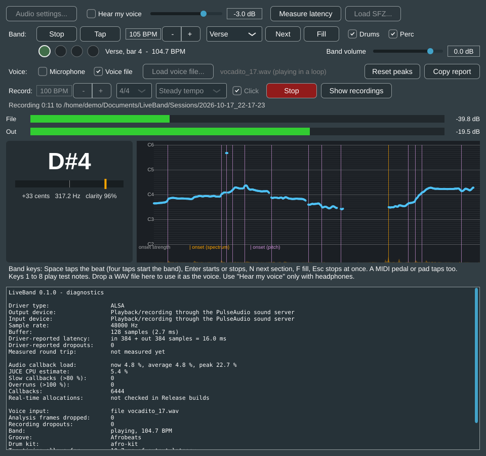
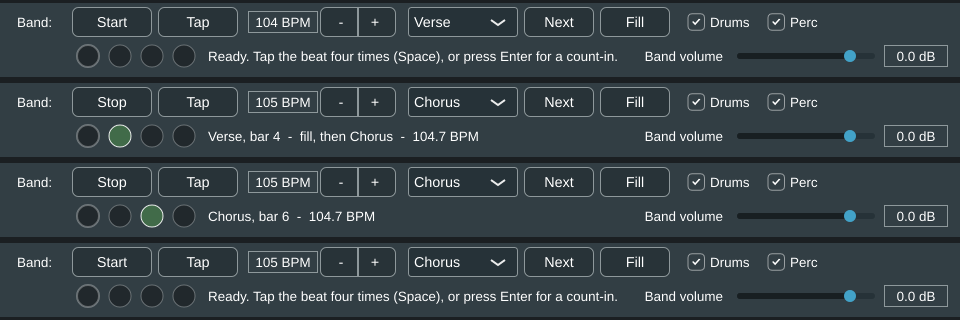
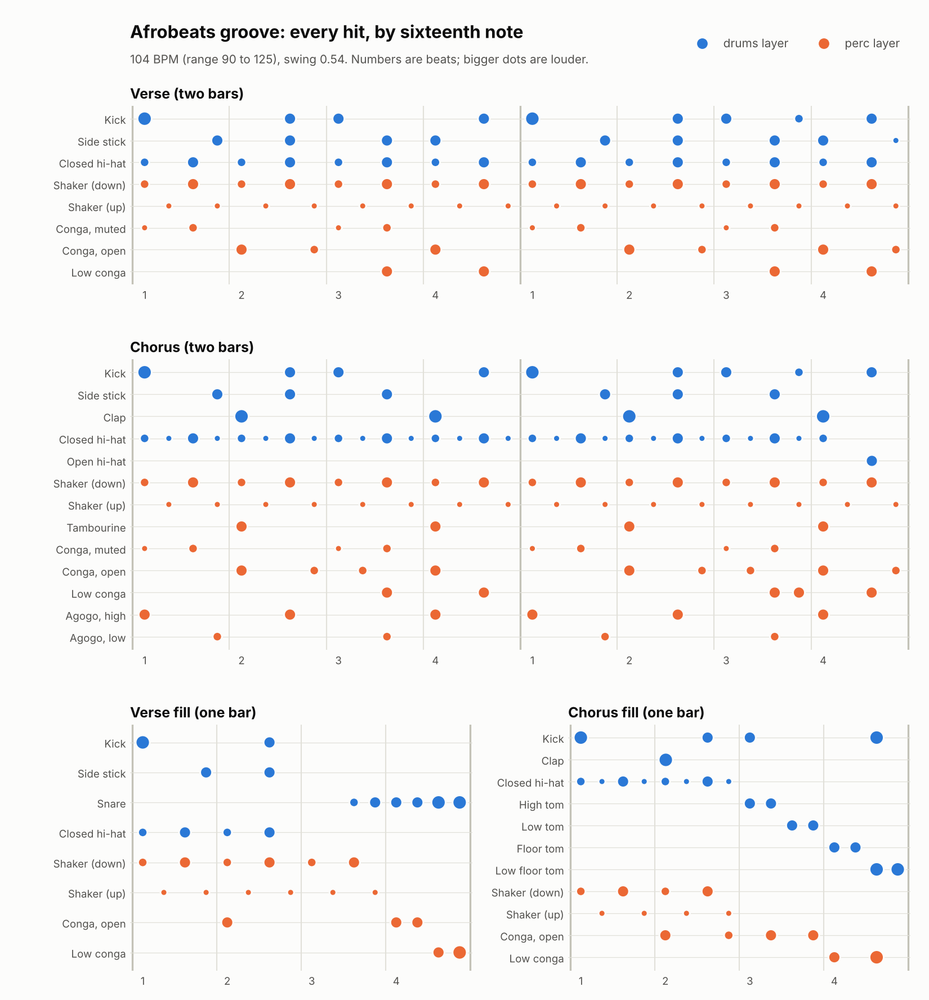
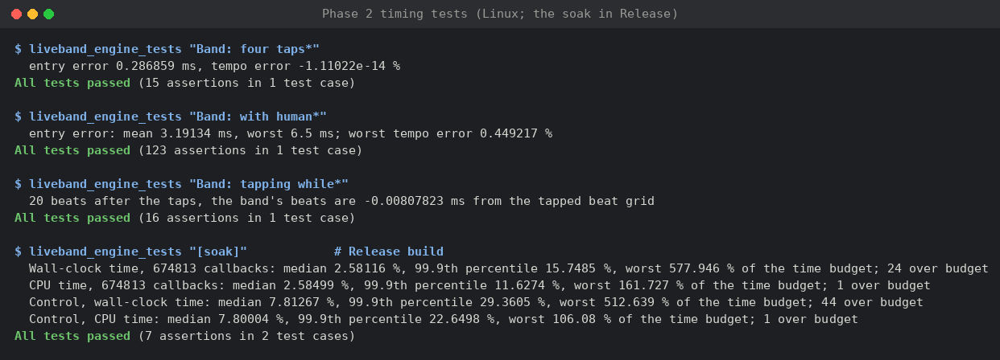
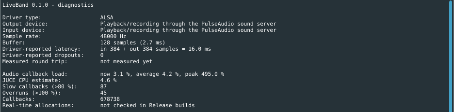
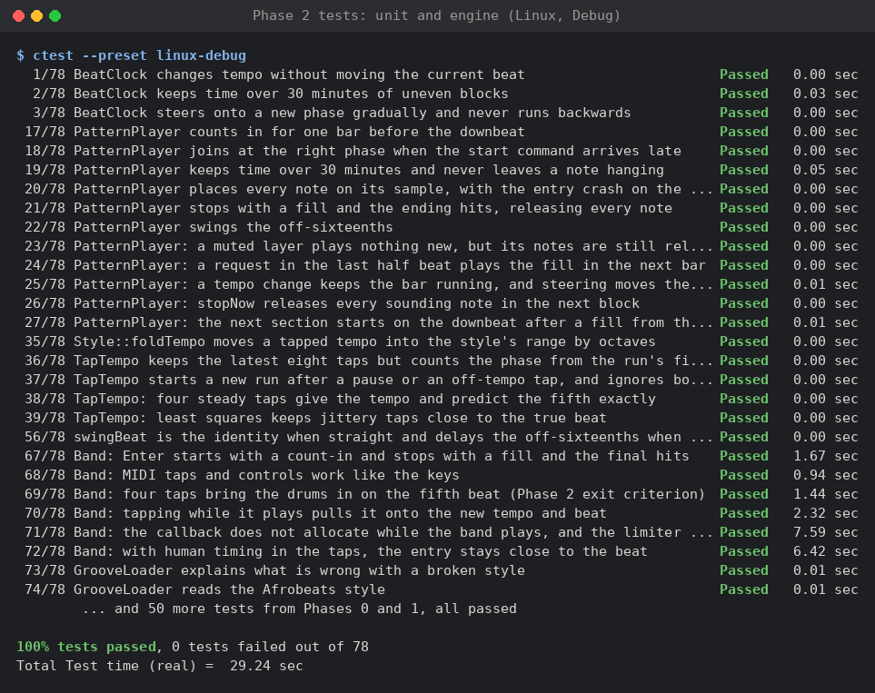

# Phase 2 results: the band plays

Measured on 17 October 2026, on the `phase-2-play` branch.

## Summary

| Phase 2 exit criterion | Result | Target | |
|---|---|---|---|
| After four taps, the drums start on the fifth predicted tap (engine test, exact taps) | **0.3 ms** entry error, tempo exact | < 10 ms, < 0.5% | met |
| The same with human timing: taps off by up to 5 ms, 20 tempos from 92 to 111 BPM | **3.2 ms** average, 6.5 ms worst; tempo at most **0.45%** off | < 10 ms, < 0.5% | met |
| The same, measured through the loopback on the Lenovo laptop | not yet measured | < 10 ms, < 0.5% | to do |
| No hanging notes | every note-on released, after 30 simulated minutes of random section changes and fills, and after stops and panics | none | met |
| No drift | the last beat of a simulated 30 minutes within **1 sample** of the ideal | < 1 sample | met |
| 30-minute soak, file input, band playing: the engine's own work | median **2.5%** of the time budget, 999 callbacks in 1000 under **12%**; 0 to 2 callbacks per run over budget, no more than a loop doing identical work on this machine | under 100% | met for the sustained cost; spikes need the laptop |
| The same soak in the running app on the cloud machine | 0 driver dropouts; **45 overruns** in 678,738 callbacks (0.007%), from the OS pausing the audio thread | 0 xruns, 0 overruns | not met here; to repeat on the laptop |

Like Phase 1, these measurements come from the cloud test machine: engine tests that
drive the audio engine with a simulated device, and the app itself running at real-time
speed on a virtual sound device. The laptop test in
[WINDOWS_SETUP.md](../WINDOWS_SETUP.md) (section 6) repeats the timing on real hardware.

The soak overruns are explained under [Soak](#soak): the engine typically needs 2.5% of
its time, but the cloud machine is a virtual machine that runs the app without real-time
priority, so other work can pause or slow the audio thread. A control loop doing the
same work in every callback shows the same rare spikes there. On Windows, JUCE runs the
audio thread at the "Pro Audio" priority, and the soak has to be repeated there.

## What the band does



A new row under the audio settings controls the band. The lights show the beat being
heard (the app allows for the output latency), and the line beside them says what the
band is doing.



- **Start by tapping:** four taps on the space bar (or a MIDI pedal or pad), and the
  band comes in on the fifth beat. Taps at half or double speed are moved into the
  style's range (90 to 125 BPM).
- **Start with a count-in:** Enter plays a bar of sticks, then the band.
- **Sections:** N plays a fill from the current beat to the end of the bar and starts
  the next section on the next downbeat, with a crash, the way arranger keyboards
  behave. F plays a fill and stays.
- **Taps while playing** pull the band onto the tapped tempo and beat over a few beats,
  never jumping or running backwards.
- **Stop:** Enter plays a fill, then a kick and crash on the next downbeat. Esc stops
  at once.
- **Mix:** the drums and percussion layers can be switched off, the band has a volume
  control, and a limiter keeps the output under -1 dBFS.
- **Recording:** sessions now also save `beats.csv`, when each band beat was sent to the
  output, next to the singer's analysis.

## The drum kit

| Part | Source |
|---|---|
| Kick | Synthesized by `tools/python/make_afro_kit.py`: a deep, short kick falling from 165 Hz to 52 Hz, with a knock and a click so it carries on small speakers. Two variations alternate. |
| Snare, side stick, hi-hat, cymbals, toms, claps | [Versilian Community Sample Library](https://github.com/sgossner/VCSL) (CC0) |
| Shaker, congas, bongos, tambourine, cabasa, agogo, cowbell, claves, woodblock | VCSL (CC0) |

The kit maps 31 sounds to General MIDI drum notes, so any GM drum pattern plays on it.
The script balances the pieces by measuring each sample's loudest 50 ms at full
velocity: kick and snare lead, the hi-hat sits about 15 dB under the kick, and the
shaker and congas carry the bounce just behind the drums. Hi-hats choke each other,
and every piece keeps its velocity layers and round-robin variations from VCSL.

The 116 VCSL samples (41 MB) are not committed: `tools/python/fetch_assets.py`
downloads them from a pinned commit and checks their SHA-256 sums. CI fetches them, so
the Windows download contains the whole kit. Without them only the kick plays and the
app says so. The kit loads entirely into memory, so nothing is read from disk while
the band plays.

## The groove



The patterns follow common modern Afrobeats practice: the kick on 1, the "and" of 2, 3
and the "and" of 4; the side stick on the son clave rhythm; a 16th-note shaker accented
on the off-beats; congas around the snare beats. The chorus adds claps on 2 and 4,
16th-note hi-hats with an open hat into the next bar, tambourine and agogo. The 16ths
swing slightly (0.54). Each grid is written out in `tools/python/make_grooves.py`,
which writes ordinary MIDI files, so a musician can change a pattern by editing a line
of text, or by editing the MIDI files in any DAW.

These patterns are a starting point. **A Nigerian drummer, keyboardist or producer
should review them before the demo** (question 3 in section 10 of the plan).

## Timing

**How a tap start works.** Each tap is timestamped on the system clock (key presses
when the app receives them; MIDI messages carry their own timestamps). A straight line
fitted to the taps by least squares gives the tempo and predicts the fifth tap. The
app converts that time to a sample on the audio timeline with a time map that the
audio thread updates every callback, and subtracts the output latency (half the
measured round trip, or the driver's figure plus one buffer), so the downbeat is
*heard* on the predicted beat.

**Engine tests.** A simulated device with callbacks up to 1.5 ms late, as real drivers
are, and a 160-sample output latency. With exact taps at 104 BPM, the first sound is
heard 0.3 ms after the predicted beat, which is the attack of the kick sample. With
each tap moved randomly by up to ±5 ms, across 20 tempos from 92 to 111 BPM, the entry
error averages 3.2 ms (worst 6.5 ms) and the tempo error stays under 0.45%. Most of
that error is the taps' own: four taps cannot predict the fifth more precisely than
they are played.

**In the running app.** A session recorded while tapping the band in, on the virtual
sound device, shows the kick in `output.wav` starting within **0.25 ms** of every
downbeat logged in `beats.csv` (measured by cross-correlating with the kick sample).
Notes are placed on their exact sample inside each audio block.

**Steering.** Taps while the band plays move it onto the new tempo at once and onto the
new beat gradually: at most 8% faster or slower, settling with a one-beat time constant.
In the engine test, a singer settling 6% slower and 120 ms off the band's beat has the
band on their beat 20 beats later (0.01 ms off the tapped beat grid).

**Still to measure:** the whole chain on the laptop, including the keyboard's own delay
in reporting a key press. `tools/python/check_tap_entry.py` measures it from a session
recorded with the mic against the ear cup (WINDOWS_SETUP.md, section 6).

## Soak

Two 30-minute runs, both in Release with a 128-sample buffer (2.7 ms per callback), the
voice analysis listening to a looping vocadito clip, and the band playing Afrobeats at
104 BPM, changing section and filling every 30 seconds.

**The engine on its own** (`liveband_engine_tests "[soak]"`), as fast as the machine
allows, timing each callback both by the wall clock and by the CPU time its thread used.
The same test group runs a **control**: a loop doing identical arithmetic in every
"callback" (about three times the engine's typical cost), timed the same way. Ranges over
repeated runs:

| Per callback, % of its 2.7 ms | Median | 99.9th percentile | Worst | Callbacks over budget, per run |
|---|---|---|---|---|
| Engine, CPU time (10 runs) | 2.3 to 2.6% | 7.8 to 11.6% | 33 to 162% | 0 to 2 |
| Control, CPU time (7 runs) | 7.8 to 7.9% | 21.8 to 23.6% | 94 to 643% | 0 to 8 |
| Engine, wall-clock time (11 runs) | 2.3 to 2.6% | 9.4 to 15.7% | up to 1,076% | 4 to 26 |

The control does exactly the same work every time, yet its slowest callbacks take 20 to
80 times its median, more often than the engine's. So the rare spikes, in CPU time as well
as wall-clock time, come from the virtual machine (other guests, interrupts, time the
hypervisor takes), not from the engine's work. The wall-clock overruns mostly used well
under 1 ms of CPU: the thread was waiting for the processor. The test checks the
sustained cost (the 99.9th percentile under 25%) and reports the spikes without failing
on them.



**The running app**, on the virtual sound device, for 1,801 seconds of real time
(785 bars):



The average load is 4.2%, the driver reported no dropouts, no analysis frames were
dropped, and the band ended at bar 786 at the tempo it started with. But 87 callbacks
took over 80% of their time and 45 over 100%, with one at 495% (13 ms). The engine's
typical cost is 2.5%. The container gives no process real-time priority (`ulimit -r` is
0, and every thread of the app runs at normal priority), so the audio thread also waits
behind the app's own window drawing and the sound server, on top of the virtual
machine's own pauses.

So the exit criterion is **met for the engine's sustained cost but not shown for the
app**: the app soak has to be repeated on the laptop (WINDOWS_SETUP.md, section 4, step
7, with the band playing), where WASAPI exclusive mode and MMCSS give the audio thread
priority. The Phase 5 soak with LatencyMon is the final check.

## Cost

| Measure | Value |
|---|---|
| `lb-render`, Release, 42 s of Afrobeats through the full kit | 4.7 s on one core of the cloud machine (Xeon, 2.1 GHz), kit loading included: about 9× real time |
| App, Release, 128-sample buffer, band plus voice analysis | average callback load 4.2% over 30 minutes |
| Engine, CPU time per callback | median 2.3 to 2.6%, 99.9th percentile at most 11.6% of the budget |

A Debug build renders the kit slower than real time (sfizz is not optimized in Debug),
so the app must be built as Release for playing.

## Tests



New unit tests cover the beat clock (no drift over 30 minutes, tempo changes, steering),
the pattern player (sample-accurate notes, count-in, fills and section changes, the
ending, layer muting, swing, late starts, and a 30-minute random workout with no
hanging notes and no allocations), tap tempo, tempo folding and swing. New engine tests
cover the groove loader, the four-tap entry, steering, the count-in start and stop,
MIDI control, and the callback with the band playing: no memory allocations and no
output above -1 dBFS.

## How to reproduce

```
python tools/python/fetch_assets.py
cmake --preset linux-release && cmake --build --preset linux-release
ctest --preset linux-release
out/build/linux-release/liveband_engine_tests_artefacts/Release/liveband_engine_tests "[soak]"
out/build/linux-release/lb-render_artefacts/Release/lb-render --style assets/grooves/afrobeats \
    --kit assets/sfz/afro-kit/afro-kit.sfz --plan Verse:8,Chorus:8 --count-in --out afrobeats.wav
python tools/python/plot_groove.py --out groove.png
```

To change the groove: edit the grids in `tools/python/make_grooves.py` and run it. To
change the kit: edit the table in `tools/python/make_afro_kit.py` and run it (it needs
the packages in `tools/python/requirements.txt`).

## Open items

- The tap-entry measurement on the laptop, through the loopback.
- A review of the groove by a Nigerian musician.
- Whether section changes should wait for the end of a phrase (plan, section 10).
- Keyboard taps include the keyboard's delay, which the app cannot see; a MIDI pedal
  avoids it. If the laptop test shows a steady lateness, a tap offset setting can
  remove it.
- The app soak on the laptop: 0 overruns and 0 dropouts over 30 minutes with the band
  playing.
- Phase 4 checks that re-tapping re-locks within one bar: today a half-beat phase
  correction takes up to about six beats.
