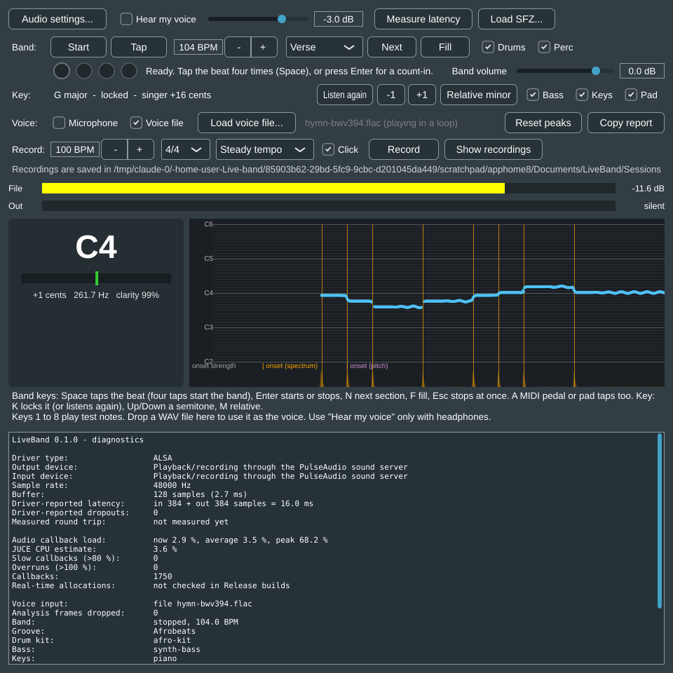
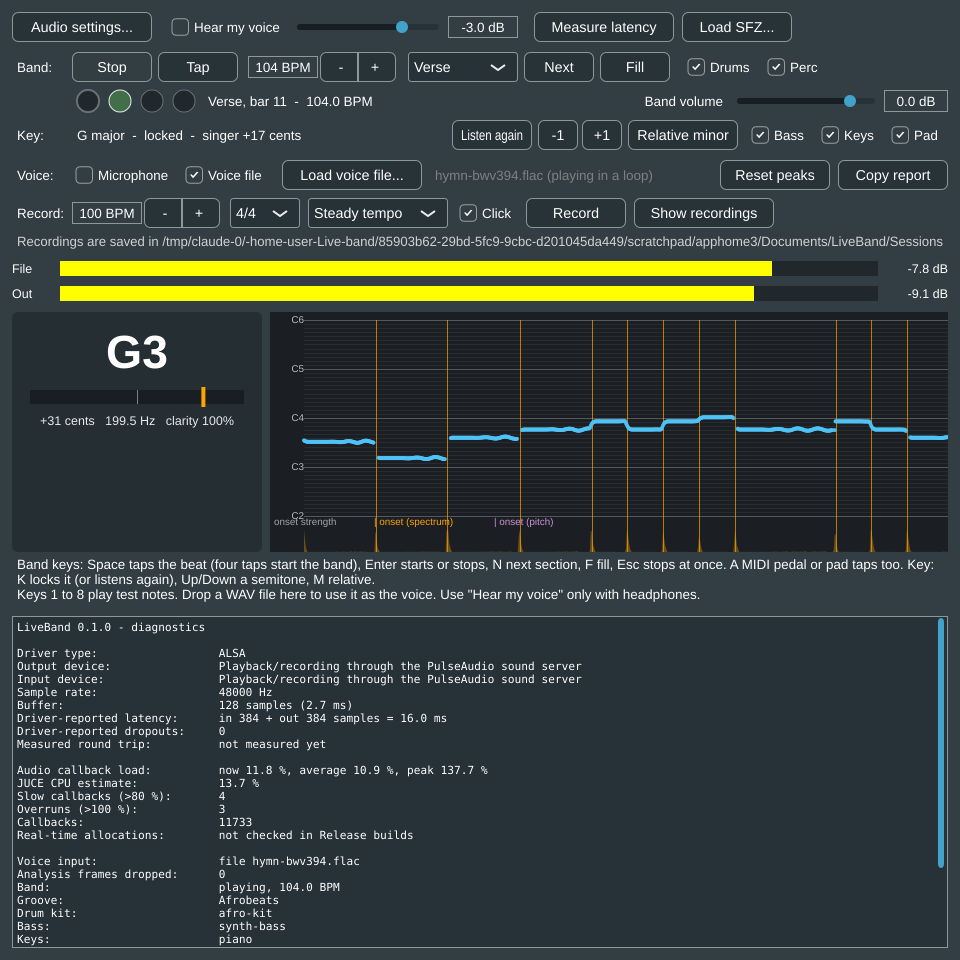
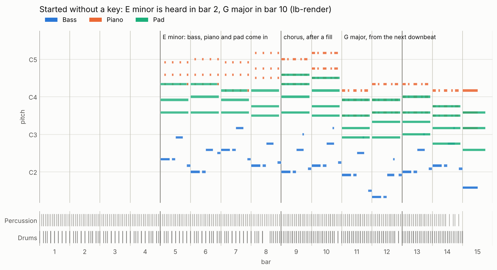
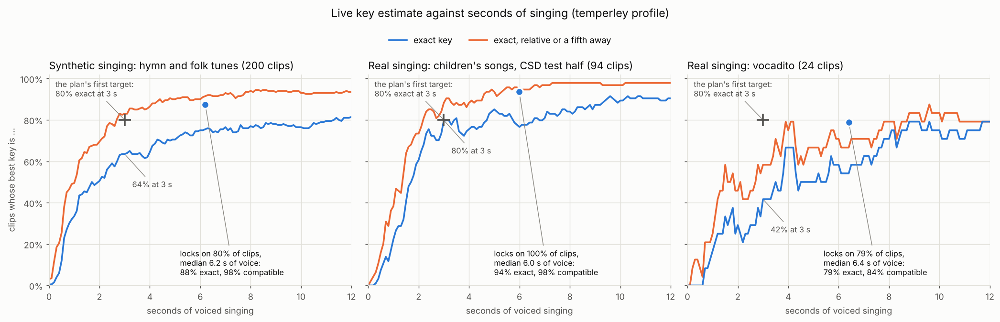
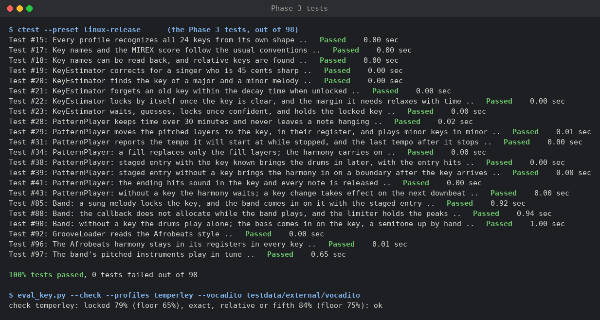

# Phase 3 results: key and layering

Measured on 18 October 2026, on the `phase-3-key` branch.

## Summary

| Phase 3 exit criterion | Result | Target | |
|---|---|---|---|
| Exact key from the first 3 s of voiced singing | **62%** of 200 synthetic sung clips, **42%** of 24 real ones (vocadito); MIREX score 0.69 and 0.46 | ≥ 80% exact | **not met** (see below) |
| The key the band actually plays: the estimator's own lock | synthetic: locks on **80%** of clips after a median **5.6 s** of voice; **82%** exact, **96%** exact, relative or a fifth away. vocadito: 75%, 7.9 s, 72%, 83% | (proposed instead) | to agree with the owner |
| Staged entry works live | in the running app: pad and piano in bars 1 to 4, drums from bar 5, bass from bar 9, all in the sung key (G major), measured from the app's own output | works | met on the cloud machine; to repeat on the laptop |
| Transposed bass and keys stay in their registers | in all 24 keys: bass D1 to C4, piano E3 to Eb5, pad Ab2 to Bb4 | stays in register | met |
| No hanging notes on transposition or section changes | every note-on released after 30 simulated minutes of random section changes, fills and key changes, and after key changes during held chords | none | met |
| 30-minute soak with the full band (engine) | median **6.9%** of the time budget, 999 callbacks in 1000 under **21%** CPU time; 1 callback over budget, as many as a control loop doing identical work | under 100% | met for the sustained cost; spikes need the laptop |
| The running app on the cloud machine, 5 minutes with the full band | average load 13.7%; **81 overruns** in 114,336 callbacks (0.07%), against 56 with the drums alone in the same conditions | 0 overruns | not met here; to repeat on the laptop |

As in the earlier phases, everything here was measured on the cloud test machine: unit
and engine tests, offline evaluations, and the app itself running in real time on a
virtual sound device. The laptop checks are in [WINDOWS_SETUP.md](../WINDOWS_SETUP.md),
section 7.

### Why the 3-second target is not met, and what I propose

Three seconds of singing is usually four to eight notes. Often they do not yet contain
the notes that tell a key from its neighbours: a tune that starts on the fifth and the
sixth of the scale fits its key, the relative minor and the key a fifth away about
equally well. Even after the whole 15-second clip, the best profile gets 82% of the
synthetic clips exactly right (91% of the folk tunes, 73% of the hymn tunes).

The band does not need the key at 3 seconds. Started before the key is known, it plays
the drums and percussion alone and brings the bass, piano and pad in on the first
four-bar boundary after the key locks. So the estimator waits until it is sure: it locks
when the best key's correlation leads the second's by a margin that starts at 0.25 and
relaxes to 0.1 between 2 and 10 seconds of voice. A clear melody locks early; an
ambiguous one is given more time. When it locks, the key is exact on 82% of the
synthetic clips, and exact, relative or a fifth away (harmonically close; the relative
key uses the same notes) on 96%.

I propose that the Phase 3 exit criterion is judged at that lock: **at least 80% exact
and 95% harmonically compatible when the key locks, with a median under 6 s of voice**,
and that the lock settings are re-tuned on recordings of Nigerian singers once there are
some (Phase 5). That is for the owner to decide.

Three cautions about these numbers:

- The synthetic clips are hymn and folk melodies sung by a simple synthetic voice, with
  vibrato, glides, random tuning (up to 40 cents off) and random transposition. Real
  singers are less steady.
- vocadito has no key labels. Its reference key is the one at least three of four
  standard key-finding profiles give for the hand-annotated notes, so only 24 of its 40
  clips have one, and the reference leans towards what profiles find.
- The lock margins were chosen by looking at both test sets; there is no held-out set.
  The numbers are therefore optimistic.

## What the band does now



A new **Key** row shows what the app hears and what the band plays:

- **Listening**, until there are 2 seconds of singing; then **Hearing G major (64 % sure)**,
  with how close it is to locking; then **G major, locked**. While locked, the app keeps
  listening and shows a different key if it starts to hear one.
- The singer's **tuning**: how far they are from A440, which the key detection allows for.
- **Lock** (K) locks the key it hears now. When locked, the same button reads **Listen
  again**: the app forgets what it heard and listens afresh, and the band keeps its key
  until the new one locks.
- **-1** and **+1** (Down and Up arrows) move the key a semitone. **Relative minor** /
  **Relative major** (M) swaps between, for example, C major and A minor.
- **Bass**, **Keys** and **Pad** switch those parts on and off, like Drums and Perc.

Every change of key takes effect on the band's next downbeat. Once the band has stopped,
the app listens afresh for the next song.



How the band comes in depends on whether the key is known (the style's staged entry):

- **Key known when the band starts:** pad and piano on bar 1, drums and percussion on
  bar 5 (with a crash), bass on bar 9.
- **Key not known yet:** drums and percussion from bar 1; bass, piano and pad join on the
  first four-bar boundary after the key locks.

Fills now replace only the drums and percussion; the harmony carries on through them.
The ending hits include the tonic and fifth on the bass, piano and pad. Sessions record
the band's key and the parts playing on every beat (`beats.csv`), and the key decision in
`session.json`.

## The harmony

| Part | Instrument | Range in any key |
|---|---|---|
| Bass | A round synth bass made by sfizz's oscillators: a sine for the body and a filtered saw for the attack (no samples) | D1 to C4 |
| Keys | The Kawai grand piano of the [Versilian Community Sample Library](https://github.com/sgossner/VCSL) (CC0): one velocity layer, 11 samples from A2 to E6, each levelled and tuned to A440 by measurement | E3 to Eb5 |
| Pad | Five detuned saws through a low-pass filter, with a triangle an octave down (no samples) | Ab2 to Bb4 |

All three are generated by `tools/python/make_band_kits.py`; the piano's samples (40 MB)
are downloaded with the drum kit's by `tools/python/fetch_assets.py`. A test plays each
instrument and measures its pitch: the bass and pad are within 5 cents, the piano within
2 to 6 cents.

The parts are written in C major and C minor, over four-bar progressions:

| Section | Major | Minor |
|---|---|---|
| Verse | C G Am F (I V vi IV) | Cm Ab Eb Bb (i VI III VII) |
| Chorus | F G Em Am (IV V iii vi) | Ab Bb Cm Cm (VI VII i i) |

The bass locks with the kick (root on 1 and the "and" of 2, the fifth on 3, a step
towards the next chord at the end of the bar; an octave pop in the chorus). The piano
plays off-beat stabs in the verse and a syncopated figure in the chorus; the pad holds
the chord. In another key, the parts move by -6 to +5 semitones from C, so they stay in
their registers, and a minor key plays the minor version.

Levels were set against the drums by measuring each part alone, while all four play
(BS.1770 K-weighting, without gating): drums -24.6 LUFS, bass -26.8, piano -28.8,
pad -34.4.



The parts are generic pop and Afrobeats voicings: **a Nigerian keyboardist or producer
should review them**, with the drum grooves, before the demo.

## Key detection

The design follows section 4.4 of the plan:

1. **Notes:** a run of voiced frames whose pitch stays within half a semitone of its
   running mean for at least 80 ms. A phrase ends after 0.3 s without voice.
2. **Tuning:** notes are placed relative to a running circular mean of their deviation
   from the A440 grid, so a singer 40 cents flat still lands on the right notes.
3. **Histogram:** each note adds its duration times a loudness weight to its pitch class;
   the last note of a phrase counts double, because phrases tend to end on the tonic.
   Before the key locks, the histogram fades with a time constant of 30 s.
4. **Score:** the correlation of the histogram with the 24 rotated major and minor key
   profiles.
5. **Decision:** nothing for 2 s of voice; then a guess; then a lock once the margin
   described above is reached.



Four profiles were compared, all from Humdrum's `keycor` (the same values as music21).
The plan also named Albrecht and Shanahan's profile, but its values could not be checked
against a published source, so Bellman and Budge's took its place.

| Profile | Synthetic: exact at 3 s | at the end | the estimator's lock: share locked / exact / compatible / median | vocadito: exact at 3 s | at the end | lock |
|---|---|---|---|---|---|---|
| Krumhansl and Kessler | 48% | 72% | 88% / 65% / 87% / 5.6 s | 21% | 62% | 88% / 38% / 48% / 6.4 s |
| Aarden and Essen | 49% | 65% | 75% / 79% / 97% / 5.7 s | 42% | 58% | 75% / 56% / 61% / 6.7 s |
| **Temperley (shipped)** | **62%** | **82%** | **80% / 82% / 96% / 5.6 s** | **42%** | **62%** | **75% / 72% / 83% / 7.9 s** |
| Bellman and Budge | 53% | 69% | 71% / 82% / 94% / 6.6 s | 29% | 58% | 71% / 59% / 71% / 7.7 s |

"Compatible" means exact, the relative key, or a key a fifth away. Temperley's profile
is best, or level best, on every measure except the share of clips that lock.

When Temperley's estimator locks a wrong key, it is mostly a close one: on the
synthetic clips 131 locks are exact, 13 relative, 8 a fifth away and 7 other (of 160);
on vocadito 13 exact, 2 a fifth away, 1 parallel and 2 other (of 18). The folk tunes are
easier than the hymn tunes (96% against 70% exact at the lock), which suggests simple,
tonic-centred worship melodies should do well, but only real recordings can tell.

The misses on vocadito come mostly from singers whose tuning is near a quarter tone off
A440 with a wide spread from note to note: some notes then fall in the semitone above or
below.

## Checked in the running app

The app ran on the cloud machine with a virtual sound device, playing a synthetic sung
hymn tune in G major (Bach's BWV 394, transposed, sung 17 cents sharp) as its voice
input. It locked **G major** with the singer at **+16 cents** before the band started
(the screenshot above). Pressing Start then brought the band in with the staged entry
for a known key. The app's output was recorded from the virtual device and measured bar
by bar:

| Bar | Bass band (30 to 120 Hz) | Piano and pad band (250 Hz to 1.5 kHz) | Hi-hats and shaker (6 to 12 kHz) | Lowest strong pitch in beat 1 |
|---|---|---|---|---|
| count-in | 25 dB | 30 dB | 34 dB | (sticks) |
| 1 | 53 dB | 55 dB | 9 dB | G (pad) |
| 2 | 54 dB | 55 dB | 8 dB | F# (pad, D chord) |
| 3 to 4 | 53 dB | 55 to 56 dB | 11 dB | G |
| 5 to 8 | 66 to 67 dB | 55 to 57 dB | 47 dB | 52 Hz (the kick) |
| 9 | 70 dB | 56 dB | 47 dB | **G1, 48.9 Hz** (the bass) |
| 10 | 70 dB | 56 dB | 47 dB | **D2, 73.6 Hz** (the bass, D chord) |

The levels are relative (dB of summed spectral power). The drums come in on bar 5 and the
bass on bar 9, playing G then D as the G major verse (G D Em C) requires.

The app was then left playing for 5 minutes, once with the full band and once with the
bass, piano and pad switched off, a few minutes apart, with nothing else running:

| 5 minutes in the running app | Average callback load | Slow callbacks (> 80%) | Overruns (> 100%) |
|---|---|---|---|
| Full band | 13.7% | 152 | **81** in 114,336 callbacks (0.07%) |
| Drums and percussion only | 7.5% | 104 | **56** in 115,143 callbacks (0.05%) |

Neither is the zero the project needs. Most of the overruns come from the machine: with
the drums alone the rate is already seven times that of the Phase 2 app soak (45 in 30
minutes), so the cloud machine was busier than it was then. It is a virtual machine
with four cores that runs the app without real-time priority, so other work can pause
the audio thread; the engine soak below, which measures only the engine's own work,
shows no sustained cost problem. But the full band adds about 45% more overruns on top,
because a longer callback is more often pushed past its deadline by such a pause. **The
laptop soak with the full band (WINDOWS_SETUP.md, section 4, step 7) decides whether
this is a problem**; if it is, the pad (five detuned saws per note) is the first thing
to make cheaper.

## Soak and cost

**The engine on its own** (`liveband_engine_tests "[soak]"`), now with the full band:
30 minutes of audio with drums, percussion, bass, piano and pad, a section change or
fill every 30 seconds, a key change every 5 minutes, and the voice analysis running on a
voice file:

| | Median | 99.9th percentile | Worst | Over budget |
|---|---|---|---|---|
| Full band, wall-clock time | 6.9% | 27.9% | 744% | 50 |
| Full band, CPU time | 6.9% | 20.6% | 111% | 1 |
| Control loop (identical work every time), CPU time | 7.8% | 22.3% | 176% | 1 |

The full band costs about three times the drums alone (median 2.5% in Phase 2), well
under the budget. The rare spikes in CPU time also hit the control loop, so they come
from the machine. The key estimator runs on the message thread and costs nothing on the
audio thread; the callback still makes no memory allocations with the full band playing
and changing key (engine test).

## Tests



98 tests pass (72 unit test cases and 26 engine test cases). New in Phase 3:

- **Key detection:** every profile recognizes all 24 keys from its own shape; a major and
  a minor melody; a singer 45 cents sharp; waiting, guessing, locking, the margin that
  relaxes with time, and forgetting an old key; key names that read back.
- **Player:** transposition in all 24 keys with the minor version in minor keys; a key
  change on the next downbeat with no hanging note; fills that keep the harmony; staged
  entry with and without a key, including the key arriving before the first downbeat;
  ending hits in the key; the 30-minute random test now changes key too.
- **Engine:** a sung melody (a synthetic voice in D major) locks the key through the
  analysis, and the band then comes in with the staged entry; without a key the bass
  stays silent, comes in on the four-bar boundary after a key is given, plays the tonic
  of G major, then of Ab major after +1, measured in the output; the full band does not
  allocate in the callback; the real Afrobeats parts stay in their registers in all 24
  keys; the bass, pad and piano play in tune.
- **CI** now fetches the piano samples, renders the full band with a key arriving and
  changing (`lb-render --key-at`), and fails if key detection on vocadito drops below
  regression floors (locked on 65% of clips, 75% of locks compatible).

## How to reproduce

```
python tools/python/fetch_assets.py                  # drum and piano samples
cmake --preset linux-release && cmake --build --preset linux-release
ctest --preset linux-release
out/build/linux-release/liveband_engine_tests_artefacts/Release/liveband_engine_tests "[soak]"

# Key detection (needs pip install -r tools/python/requirements.txt)
python tools/python/make_key_testset.py              # synthetic clips into testdata/external/keyset
python tools/python/fetch_vocadito.py
python tools/python/eval_key.py --analyzer out/build/linux-release/lb-analyze_artefacts/Release/lb-analyze \
    --labels testdata/external/keyset/labels.csv
python tools/python/eval_key.py --analyzer out/build/linux-release/lb-analyze_artefacts/Release/lb-analyze \
    --vocadito testdata/external/vocadito
python tools/python/plot_key_eval.py --analyzer ... --labels ... --vocadito ... --out key-accuracy.png

# The band, offline
out/build/linux-release/lb-render_artefacts/Release/lb-render --style assets/grooves/afrobeats \
    --kit assets/sfz/afro-kit/afro-kit.sfz --bass assets/sfz/bass/synth-bass.sfz \
    --keys assets/sfz/keys/piano.sfz --pad assets/sfz/pad/warm-pad.sfz \
    --key-at 1:Em --key-at 9:G --plan Verse:8,Chorus:6 --out band.wav --events band.csv
python tools/python/plot_harmony.py --events band.csv --bpm 104 --out band.png
```

## Open items

- **Owner decisions:** the exit criterion (above); whether the staged entry plans suit
  the band; whether the app should keep a key locked by hand after the band stops
  (today every song starts by listening).
- **Laptop checks** (WINDOWS_SETUP.md, section 7): the key locking on the owner's own
  singing, the staged entry and overrides by ear, and the soak with the full band.
- **Nigerian recordings:** sessions save the voice (`input.wav`), and the
  [recording guide](../RECORDING_GUIDE.md) asks for each song's key. A CSV with `file`
  and `key` columns is all `eval_key.py --labels` needs to score the key detection on
  them and re-tune the lock settings on real worship and Afrobeats singing. The
  recordings must not go into the public repository.
- **Musical review** of the harmony parts and progressions by a Nigerian musician.
- **Retuning the band to the singer** (sfizz's tuning frequency) when they are far from
  A440 remains a stretch goal.
