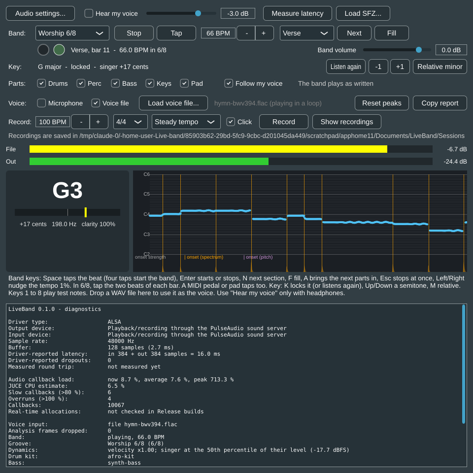
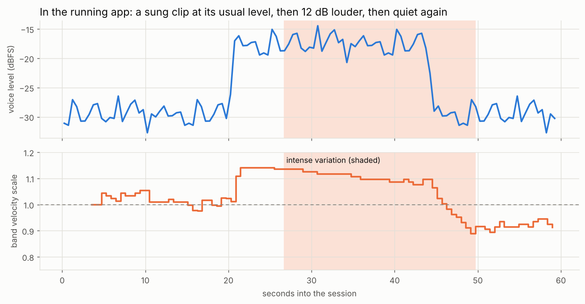
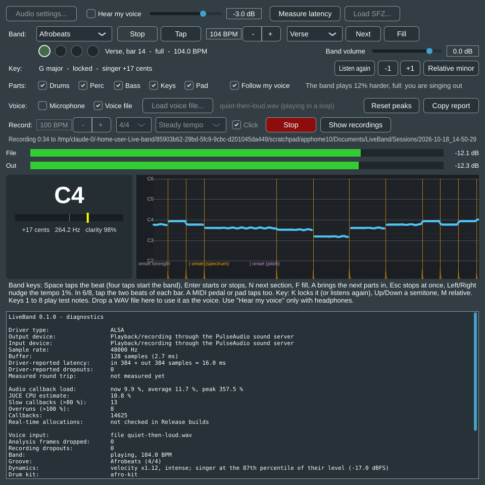
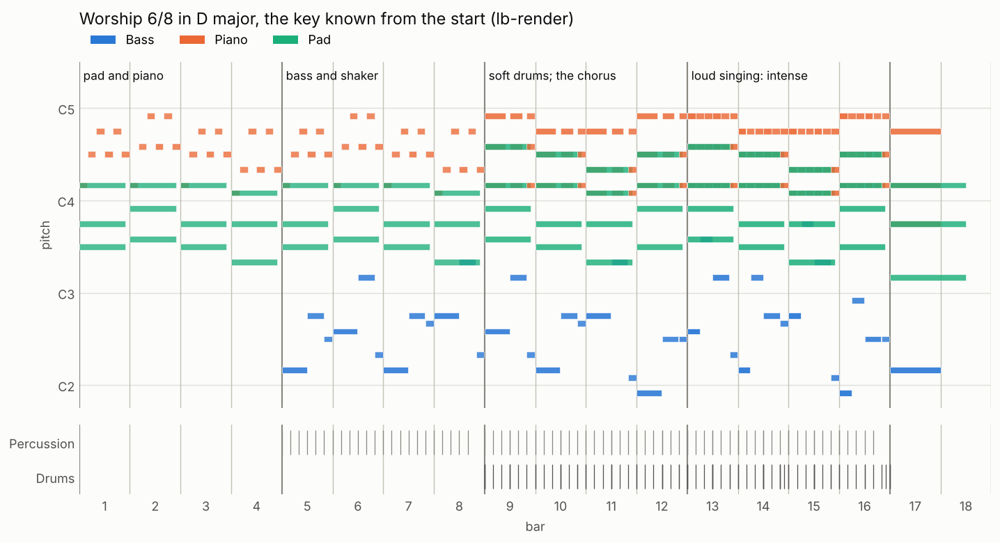
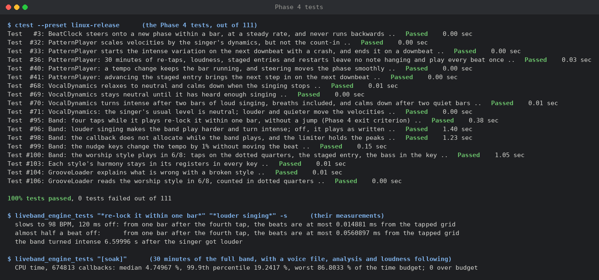

# Phase 4 results: feel, control and the 6/8 style

Measured on 18 October 2026, on the `phase-4-feel` branch.

## Summary

| Phase 4 exit criterion | Result | Target | |
|---|---|---|---|
| Re-tapping re-locks within one bar, with no hanging notes and no audible jump | engine test, the band at 104 BPM: from one bar after the fourth re-tap, every beat within **0.015 ms** of the tapped grid when the singer slowed to 98 BPM, 120 ms off the band's beat, and within **0.056 ms** when they were almost half a beat off at the same tempo. On the way, no beat came more than 15% early or late. 30 simulated minutes of random re-taps, loudness changes, staged entries, key and section changes and restarts: every beat played once, no note left hanging | within one bar, no jump, no hanging notes | met |
| The 6/8 style plays in time, with transposition and staged entry working | engine test: four taps at 66 BPM start the worship style on the fifth tap (within 2 ms), beats every 0.909 s, two dotted quarters to the bar; pad and piano from bar 1, bass and shaker from bar 5, drums from bar 9; the bass plays G in G major. Its harmony stays in its registers in all 24 keys. In the running app: **"Verse, bar 11 - 66.0 BPM in 6/8"** in the sung key | plays in time, transposes, staged entry | met on the cloud machine; the groove needs a Nigerian musician's review |
| Section changes land where the owner expects them, with the fill before them | unchanged from Phase 2: like an arranger keyboard, the fill plays to the end of the bar and the new section starts on the next downbeat | the owner's choice | **for the owner to decide** after trying it |

Also planned for Phase 4, and done:

| Item | Result |
|---|---|
| Vocal loudness drives velocity and the intense variation | engine test: the band turned intense **6.6 s** after the singer got 12 dB louder (two bars of 2.3 s, plus the smoothing and the wait for a downbeat), on a downbeat, with a crash. In the running app: 14% harder 2 s after the singer got louder, intense 6.7 s after, back to normal 5.7 s after they got quieter |
| Nudge the tempo by ±1% | engine test: 100 → 101 → 102.01 BPM with two presses, the beats moving on at the new tempo at once |
| The Nigerian worship style in 6/8 | pad- and piano-led, with soft drums and its own staged entry, as above |
| Bringing in the next parts by hand (asked for in the plan's staged entry) | A, or MIDI controller 86: the next step of the staged entry comes in on the next bar |
| 30-minute soak (engine), with loudness following | CPU time: median **4.7%** of the time budget, 99.9th percentile **19.2%**, worst 87%, **0** callbacks over budget |

As in the earlier phases, everything here was measured on the cloud test machine: unit
and engine tests, offline renders, and the app itself running in real time on a virtual
sound device. The laptop checks are in [WINDOWS_SETUP.md](../WINDOWS_SETUP.md), section 8.

## What the band does now



- **A style box** on the Band row chooses between **Afrobeats** and **Worship 6/8**. The
  choice is remembered. Changing style stops the band; the new one starts at its own tempo,
  and the beat lamps show its beats (two in 6/8).
- **Follow my voice** on the Parts row (on by default, remembered) makes the band follow how
  loud the singer is. The text beside it says what it does: *Listening to how loud you
  sing...* for the first 8 seconds of singing, then for example *The band plays 12% harder,
  full: you are singing out*, or *Off: the band plays as written*.
- **Left** and **Right** nudge the tempo 1% slower or faster (MIDI controllers 84 and 85).
  Stopped, they change the tempo the band will start at.
- **Re-tapping** while the band plays pulls it onto the new beat within one bar.
- **A** brings the next parts of the staged entry in on the next bar (MIDI controller 86).
  Without a key it cannot bring the harmony in early: that step only exists once the key
  is known.

The band line says **full** while the band plays its intense variation, and **in 6/8** for
the worship style. Sessions record the velocity scale and the intense variation on every
beat (`beats.csv`), and the diagnostics report where the singer's level sits in their own
range.

## Following the singer's loudness



How it works (`VocalDynamics`, on the message thread, from the voice analysis):

- **Level:** the level of voiced frames in dB, smoothed over 1.5 s. Smoothing in dB, not in
  power, lets it fall back after a loud passage as quickly as it rose.
- **Where it sits in the singer's own range:** the percentile of that level in the
  session's distribution of it, which fades over 10 minutes so that it follows a long
  service. Each moment counts as a spread of 3 dB around its level, so that a very even
  singer's small wobbles do not swing the band: it takes a few dB. Until 8 seconds of
  singing it stays neutral, and without singing it relaxes back to neutral. Breaths
  shorter than a second change nothing.
- **Velocity:** every note but the count-in's is scaled from ×0.8 for the singer's quietest,
  through ×1 at their usual level (the 50th percentile), to ×1.15 for their loudest.
- **The intense variation:** after two bars above the 80th percentile, the band switches
  to the section's intense variation on the next downbeat, with a crash. After two bars
  below the 60th percentile, or without singing, it goes back, on a downbeat too. Both
  styles have intense versions of the verse and chorus: in Afrobeats the verse plays like
  a chorus (a busier bass, the chorus piano figure, a fuller pad, the chorus's hi-hat
  sixteenths, soft claps, tambourine and busier congas) and the chorus denser still (a
  snare under the claps, an open hat into every bar, tambourine in eighths, a pushier kick
  and congas, and the piano's densest figure). The plan also allowed a fill or crash
  instead; the crash on the variation's first downbeat does that job.

Checked in the running app, with a synthetic sung hymn that stays at its usual level for
20 seconds, gets 12 dB louder for 24 seconds, then goes back (the figure above, drawn from
the session's own files by `tools/python/plot_dynamics.py`):

| When | The band (from `beats.csv`) |
|---|---|
| Bars 1 to 6, the singer at their usual level | ×1.00 to ×1.03 |
| Bar 8, 2 s after the singer got louder | ×1.14 |
| Bar 10, 6.7 s after | **intense**, with a crash; ×1.14 |
| Bars 11 to 17 | intense; ×1.13 easing to ×1.08 as the loud level becomes part of the singer's range |
| Bars 18 and 19, the singer quieter from 44 s | intense; ×1.02, then ×0.95 |
| Bar 20, 5.7 s after the singer got quieter | back to the normal variation; ×0.92 |
| Bars 21 to 24 | ×0.91 to ×0.93 |

After the loud passage, the singer's usual level sits lower in their range than before,
so the band plays a little softer than in the first verse. That follows the plan (the
level against the session's own distribution), and it is the kind of thing to judge by
ear: **whether the reactions are natural, too much or too little is for the owner to say**
(WINDOWS_SETUP.md, section 8).



## Re-tapping and nudging

**Re-tapping.** In Phase 2, taps during playback pulled the band onto the new beat with a
proportional controller (at most 8% faster or slower, a one-beat time constant), which
took a few beats. Now `BeatClock` spreads the correction evenly over one bar (four beats in
4/4, two dotted quarters in 6/8), playing that bar a little faster or slower at a steady
rate, at most 15% off the new tempo. The new tempo itself takes effect at once. A
correction too large for one bar at that limit (more than 0.6 of a beat in 4/4) keeps
going at the limit until it is done.

In the engine test, the band plays at 104 BPM and the singer taps four beats:

| The taps | From one bar after the fourth tap | On the way |
|---|---|---|
| 98 BPM, 120 ms off the band's beat | every beat within **0.015 ms** of the tapped grid | no beat more than 15% early or late |
| 104 BPM, almost half a beat (0.45 of a beat) off | every beat within **0.056 ms** of the tapped grid | no beat more than 15% early or late |

The catch-up is heard as one bar played a little slower or faster (11% slower for the
half-beat case, at most 2% faster for the other), not as a jump: the beat position never moves backwards
and no note is played twice or skipped. Whether it feels smooth is a laptop check. A new
unit test runs the player for 30 simulated minutes with random re-taps (tempos within
10% of 104 BPM), loudness changes, staged entries brought in by hand, key and section
changes, fills, and about 60 stops and restarts with and without a key: every beat came
once, each within the 15% bound, no allocation on the audio path, and every note-on had
its note-off.

**Nudging.** Left and Right multiply the tempo by 1.01 or divide it by 1.01, so a step down
and a step up cancel out. The engine test nudges up twice while playing (once by key, once
by MIDI): 100 → 101 → 102.01 BPM, and every beat interval afterwards is within 0.5 ms of
the new tempo's.

## The worship style in 6/8



**6/8 in the engine.** A 6/8 style counts two dotted-quarter beats to the bar: that is the
pulse people clap to, and the one the singer taps. Its tempo is in dotted quarters per
minute (66 by default, 50 to 84). The count-in plays six sticks on the eighths, the two
beats louder. `GrooveLoader` reads 6/8, 9/8 and 12/8 time signatures this way, and any
x/4; it refuses other meters with a message. The beat lamps, the bar counter, staged entry,
fills, endings, re-tapping and the intense variation all work in beats, so they needed no
change for 6/8.

**The parts** (generated by `tools/python/make_grooves.py`, like the Afrobeats ones):

| Part | Verse | Chorus | Intense verse | Intense chorus |
|---|---|---|---|---|
| Drums | kick on 1, a rim click on 4, hi-hat on 1 and 4 | kick on 1 and 4, snare on 4, hi-hat eighths | the chorus groove, with the rim click | a busier kick, snare and clap on 4, accented hats, an open hat every second bar |
| Percussion | shaker eighths | shaker eighths, tambourine on 4 | as the chorus | accented shaker, tambourine on 1 and 4 |
| Bass | the root on 1, the fifth on 4, a step to the next chord on the last eighth | the same | the root for a dotted eighth, then the octave (two against three) | the same |
| Piano | eighth-note arpeggios | chords on 1, 4 and the last eighth | as the chorus | chords on every eighth |
| Pad | the chord held through the bar | fuller, with the root doubled an octave up | fuller | fuller |

| Section | Major | Minor |
|---|---|---|
| Verse | I IV I V (C F C G) | i iv VI V (Cm Fm Ab G, with the major dominant of church harmony) |
| Chorus | IV I V vi (F C G Am) | VI VII i i (Ab Bb Cm Cm) |

**Staged entry.** With the key known when the band starts: pad and piano from bar 1, bass
and shaker from bar 5, the drums from bar 9 with a soft crash. Without a key: drums and
shaker first, and the harmony from the first four-bar boundary after the key locks.

**The mix.** The instruments' own levels were set for Afrobeats, so a style can now set
its part levels (`"mix"` in `style.json`): the worship style raises the piano by 4 dB and
the pad by 6 dB, and lowers the bass by 2 dB. Measured from each part alone while all play
(BS.1770 K-weighting, without gating), against the drums: piano **+2.2 LU** (−1.8 before),
pad **−2.3 LU** (−8.3), bass **−2.0 LU** (0.0).

**Checked:**

- The engine test taps four beats at 66 BPM: the beats come every 0.909 s, two to the bar,
  the first one within 2 ms of the fifth tap; the parts come in as planned; the bass plays
  G at the start of bar 5 in G major.
- The loader test reads the time signature, two beats to the bar, and the notes at their
  dotted-quarter positions; the register test plays the worship harmony in all 24 keys.
- In the running app (the screenshot at the top), the style played in G major, the key
  locked from the sung hymn, two beat lamps, *Verse, bar 11 - 66.0 BPM in 6/8*.
- CI renders it in B flat minor, through the drums coming in and an intense passage.

The parts are a first draft written from general knowledge of Nigerian worship in 6/8,
not from recordings: **a Nigerian church musician should review the groove, the
progressions and the balance** before the demo.

## Soak and cost

Each part's own cost in the worship style, from `lb-render --live` (sfizz at the app's
live quality, three runs of 16 bars):

| Part | Share of real time | Voices at most |
|---|---|---|
| Drums and percussion | 0.6 to 0.8% | 15 |
| Bass | 0.3 to 0.4% | 4 |
| Piano | 0.6 to 0.8% | 9 |
| Pad | 1.3 to 1.7% | 8 |

2.8 to 3.7% in all, a little less than the Afrobeats band (3.2 to 4.5% in Phase 3).

**The engine on its own** (`liveband_engine_tests "[soak]"`): 30 minutes of the full
Afrobeats band, a section change or fill every 30 seconds, a key change every 5 minutes,
the voice analysis and the loudness following running on a real singer's recording
(vocadito 17, in a loop):

| | Median | 99.9th percentile | Worst | Over budget |
|---|---|---|---|---|
| Phase 3, CPU time | 4.6% | 15.3% | 126% | 1 |
| **Phase 4, CPU time** | **4.7%** | **19.2%** | 87% | **0** |
| Phase 4, wall-clock time | 4.7% | 24.9% | 782% | 42 |
| Control loop (identical work every time), CPU time | 7.6% | 23.8% | 125% | 1 |

The loudness following runs on the message thread, and the per-style part levels cost a
multiplication, so the audio thread's cost is unchanged. The wall-clock spikes are the
machine's (the control loop has them too, 35 over budget); the laptop soak decides.

## Tests



111 tests pass (80 unit test cases and 31 engine test cases). New in Phase 4:

- **Re-tapping and nudging:** the clock steers onto a new phase within a bar at a steady
  rate and never runs backwards, and a correction too large for a bar continues at the
  limit; the engine re-locks within one bar from two directions; the nudge keys and MIDI
  change the tempo by 1% without moving the beat.
- **Dynamics:** the loudness follower stays neutral until it has heard enough, places the
  usual level in the middle, turns intense after two bars of loud singing (breaths
  included) and calms down after two quiet bars or silence; the player scales velocities
  but not the count-in, and starts and ends the intense variation on downbeats, with a
  crash at the start only; in the engine, a voice that gets 12 dB louder makes the band
  play harder and turn intense, and switching the follower off brings it back to the
  written parts.
- **6/8:** the loader reads the worship style in dotted quarters; the engine plays it in
  time from four taps with its staged entry and the bass in the key; the register test
  covers both styles.
- **Bringing parts in:** advancing the staged entry brings the next step in on the next
  downbeat, with the entry crash.
- **30 minutes of everything at once** (above): re-taps, loudness, staged entries, keys,
  sections, fills, stops and restarts.
- **CI** renders the Afrobeats band with loud singing in bars 6 to 8, and the worship
  style through the drums coming in and an intense passage.

## How to reproduce

```
python tools/python/fetch_assets.py                  # drum and piano samples
cmake --preset linux-release && cmake --build --preset linux-release
ctest --preset linux-release
E=out/build/linux-release/liveband_engine_tests_artefacts/Release/liveband_engine_tests
$E "*re-lock it within one bar*" "*louder singing*" -s   # the measurements above
$E "[soak]"

# The worship style, offline (--live times each part at the app's quality)
out/build/linux-release/lb-render_artefacts/Release/lb-render --style assets/grooves/worship-6-8 \
    --kit assets/sfz/afro-kit/afro-kit.sfz --bass assets/sfz/bass/synth-bass.sfz \
    --keys assets/sfz/keys/piano.sfz --pad assets/sfz/pad/warm-pad.sfz \
    --key D --plan Verse:8,Chorus:8 --intense 12-16 --out worship.wav --events worship.csv
python tools/python/plot_harmony.py --events worship.csv --bpm 66 --beats-per-bar 2 --out worship.png

# How a recorded session followed the singer's loudness
python tools/python/plot_dynamics.py <session folder> --out dynamics.png
```

## Open items

- **Owner decisions:** whether section changes stay like an arranger keyboard or wait for
  the phrase boundary; whether the band's reactions to loudness are natural, too much or
  too little (the velocity range, the two-bar hold, and the band playing softer after a
  loud passage).
- **Laptop checks** (WINDOWS_SETUP.md, section 8): the 6/8 style by ear, re-tapping and
  nudging during a song, the loudness following with a microphone, and the soak.
- **Musical review** of the worship style and both styles' intense variations by a
  Nigerian musician.
- **Phase 5:** live sessions with at least three singers, the 30-minute live soak, and the
  demo. Automatic tempo following remains a stretch goal.
